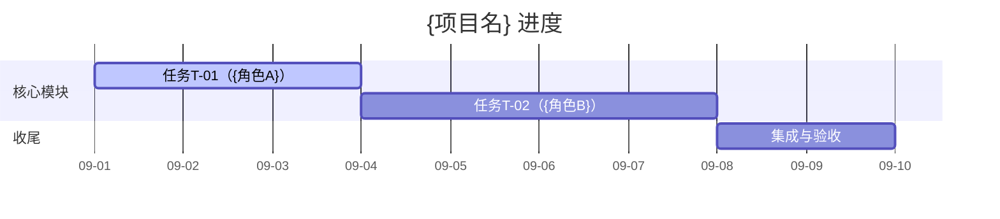

# 信箱与看板说明（多Agent协作文档治理 · 参考资料）

## 一、异步信箱（L3）规则

### 目录结构
```
{项目根}/沟通/
├── {角色A简称}/      ← 角色A 的收件箱（别人对 A 说话的地方）
├── {角色B简称}/
├── 用户/             ← 可选：用户对全员/某角色的留言
└── …
```
> 每位 agent 的主责收件箱 = 别人对其说话的地方。角色用**简称**命名子文件夹（如"技术美术""脚本工程师"）。

**轻量模式（单文件信箱）**：若项目为轻量档（1~2 agent），不建按角色子文件夹，改为单一文件 `沟通/投递.md`。所有人往里追加信件，**仍按下面的逐条格式写**（一条一个标题 + `来源：`/`接收方：`/`状态：`；嫌啰嗦至少用 `@<接收人>` 标目标），并在 `主题` 行标注目标，例：`主题：@技术美术 着色器接口确认`。**每条必须有状态**：轻量模式也逐条计积压，不再靠"整文件里有没有 `[已处理]` 字样"放过。信件攒到 >20 条或最早未处理 >7 天 ⇒ 升级为按角色拆信箱（体检 [6] 会报警）。

### 信件命名
`沟通/<接收人简称>/<说话人简称>对<接收人简称>.md`
- 例：着色器开发者要对技术美术说 → `沟通/技术美术/着色器开发者对技术美术.md`
- 同一对多次通信可在文件名加序号或日期：`着色器开发者对技术美术_2026-07-27.md`

### 信件结构（**逐条计账**：一封信可以装多条消息）

**每条消息一个标题行**，标题下带三要素——编号、接收方、状态：

```
## MSG-001 {一句话主题}

- 来源：{说话人}
- 接收方：{目标角色}          # 也可写 @目标角色，脚本两种都认
- 日期：{YYYY-MM-DD}
- 状态：pending               # pending/open/todo/wip/blocked = 积压；done/closed/已处理/已回复/已闭环 = 销号
- 涉及文档与引用：{文件} §x ｜ DECISIONS.md D-xx

正文：
  {具体请求/信息/任务}
```

三条硬规矩：

1. **一条一个标题**。把两条消息塞进同一个标题下，脚本会按 `来源：` 再切，先出现的字段（比如编号行）会漏到上一条去——**结果就是积压报到错误的编号上**，比漏报更难查。
2. **混合状态逐条报**。一个文件里 2 条 `done` + 1 条 `pending` ⇒ 体检 [4] 报**那 1 条**，不会因为文件里出现过"已处理"字样就把整个文件放过（这正是 v1.3 及以前的漏报口）。
3. **状态写不认的取值＝按未处理计**。脚本宁可多报也不猜；别用"差不多了""应该完了"这类措辞当状态。

**兼容旧写法**：正文里带 `[已处理]`／`（已处理）`，或有 `处理记录：` 行的，仍按已处理计——老信箱不用返工，但新写的建议用上面的显式 `状态：`。

**轻量模式（单文件信箱）**：若项目为轻量档（1~2 agent），不建按角色子文件夹，改为单一文件 `沟通/投递.md`。所有人往里追加，**格式同上（每条一个标题 + 三要素）**，接收方写在标题或 `接收方：` 行里；`@<接收人>` 也认。轻量模式同样逐条计积压，不靠"整文件有没有已处理字样"。超过 20 条或最早未处理超 7 天 ⇒ 升级为按角色子文件夹（体检 [6] 报警）。

### 🔄 接力信格式（用于结构化交接）

当 agent 触发交接原则（SKILL.md「交接原则」）时，投递的信件应带完整上下文，让接手人无需追问即可开工：

```
## MSG-007 交接请求 - {任务名}

- 来源：{卡住的说话人}
- 接收方：{接收人}
- 日期：{YYYY-MM-DD}
- 状态：pending          # 接手人处理完再改 done
- 涉及文档与引用：{文件} §x ｜ DECISIONS.md D-xx

正文：
  卡点原因：{缺依赖 / 超能力范围 / 反复尝试无进展}
  已尝试方案：{简述，避免接手人重试}
  建议接手人：{接收人}
  下一步：{接手人开工时该先看什么}
```

### 使用纪律
- 所有人**每次开工先读自己信箱文件夹（仅根目录）**，处理未读（处理完可标记 `状态:done` 或保留备查）。
- **🔴 已处理归档（省 token 关键）**：
  - 每个信箱下建 `已处理/` 子目录。
  - agent 巡检**只 `ls` 信箱根目录，绝不递归 `已处理/`**；需要翻历史才进 `已处理/`。避免每轮重读全部旧信浪费 token。
  - **闭环判定**：回执已收 + 无后续待办 + 对应决策已决/任务已交接 → 接收人（或发件人经确认）`mv` 进 `已处理/`。
  - **待办信留根目录**：仍挂起、需我方行动、或等上游规格/接线的信不归档，留根目录直到闭环。
  - **体检脚本须知（v1.4）**：`scripts/governance_check.py` 的 [4] **逐条**统计消息积压——只扫信箱**根目录**、不递归 `已处理/`、`归档/`、`archive/`（三种目录名都当归档位，`README.md` 不算信），所以归档信不会误判成积压；每条消息单独判状态，混合状态逐条报。另有两道防自欺：① 信箱里有信件文件却**一条消息都解析不出来** ⇒ 判"尺子作废"、报格式不认识，而不是报"没有积压"；② 报告末尾打印**检查覆盖率与未检查项**，构件为零时结论是「未配置」（退出码 3），不是"健康"。
- 信道分工：决策类 → DECISIONS；改动类 → 真实锁 / 单写队列 / 文字锁（契约 §3）；协作/接力 → 信箱。

### 与记忆日志协同省 token（重要）
- **每日记忆日志按天滚动、只留近 N 天（建议 7）在根目录**，更早的移入 `memory/archive/` 冷存。所有 agent 会话加载只扫根目录，不扫 `archive/`。
- 日志只 append（防并发互冲，见契约 §12），绝不 `Write` 整体覆盖他人段落。
- 长期事实（决策/红线/约定）抽到 `MEMORY.md` 或 `memory/*.md` 子文件做索引，不堆在每日日志里。

---

## 二、进度看板（L4·升级版可选）

当项目需要"谁在做哪条、状态如何"的透明视图时使用。放在 `状态看板.md`。

### 推荐字段
| 任务ID | 任务 | owner | 状态(doing/done/blocked) | 关联决策 | 备注 |
|---|---|---|---|---|---|
| T-01 | {任务} | {角色} | doing | D-02 | |

### 状态约定
- `todo` 未启动 ｜ `doing` 进行中 ｜ `done` 完成 ｜ `blocked` 受阻（需在备注写阻塞原因/等待谁）
- 与 DECISIONS §4 执行跟踪可二选一或合并；小项目用 DECISIONS 的 Wave 即可，大项目加独立看板。

### 可视化（可选 · Mermaid 甘特图）

在看板末尾可加一段 Mermaid 甘特图，让里程碑与谁在何时做哪条一目了然（支持 Mermaid 的 Markdown 编辑器可直接渲染）：



> 注意：任务 ID（如 `t01`）与上面看板表的 `任务ID` 列（如 `T-01`）是两套编号，互不冲突；Mermaid 里的 `t01` 只是甘特条内部引用名。

---

## 三、常见陷阱（务必规避）

1. **重复建设治理文件**：已有契约/公约/看板时，不要新建第二套，合并或重定向（如 A 并入 B 并在 B 顶部标"原 A 已并入"）。
2. **决策分散**：把待拍板事项写进各自文档的"待确认"再分别问用户——必须归集到 DECISIONS。
3. **信箱变聊天记录**：信箱只放"需要对方行动/知悉"的内容，闲聊不进信箱。
4. **锁不释放**：文字锁改动完成务必移除或改 `状态:done`；真实锁（`edit_lock.py`）改完必须 `release`，否则别人撞退出码 1 只能等你租约过期。
5. **角色名不一致**：信箱子文件夹简称、契约角色表、DECISIONS 分工矩阵三处的角色名必须统一，否则投递错位（契约 §1 列了角色却没建同名信箱目录，体检 [3] 会报）。
6. **瓶颈死磕不交接**：某成员在自己区域卡住却不说，导致进度失衡。应触发交接原则（契约 §9）：及时在对话告知用户并建议切换会话，必要时投递接力信 + 看板标 `blocked`。
7. **治理腐化不自知**：长周期项目里锁过期、决策重复、角色名漂移会悄悄累积。定期跑 `scripts/governance_check.py --root <项目根>`，一次扫出九项（过期锁 / 重复决策 / 角色名漂移 / 信箱逐条积压 / 看板漂移 / 轻量信箱规模 / 决策规模 / 决策事件一致性 / 真实锁与队列），并看它打印的**检查覆盖率**——未检查项多，说明构件没配齐，不代表没问题。
8. **拿"整文件有没有已处理"当判据**：一封信里多条消息状态不同，按文件判会把待处理那条一起放过（v1.3 及以前就是这么漏的）。判据必须落到**每条消息的状态**上。
9. **只写内容不写接收方**：消息没人认领时，脚本只能回退成"整目录里最像的一条"，积压归属会判错。`接收方：` 或 `@某人` 至少写一个。
10. **把带 `状态:wip` 的示例原样抄进真实契约**：体检 [1] 会把它当成一条真的未释放锁报出来（还会算成过期）。示例要么补当前时间与心跳，要么改完就删。
